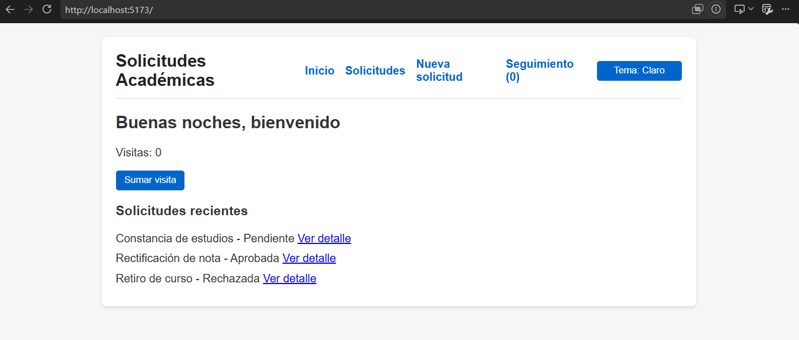
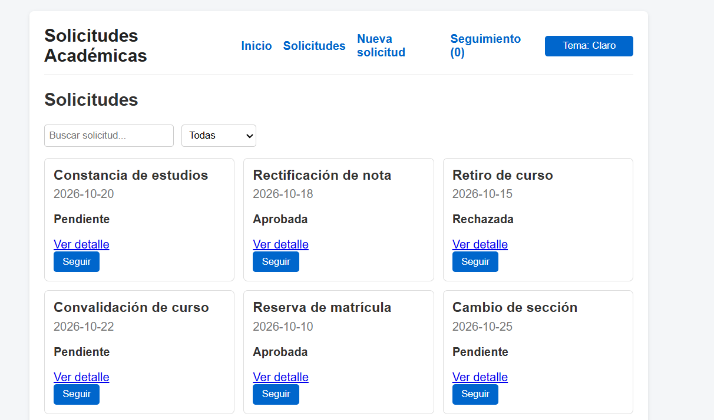
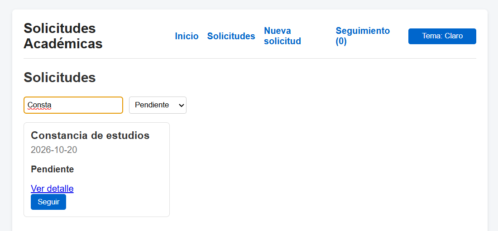
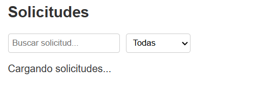
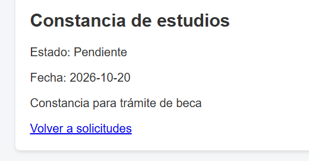
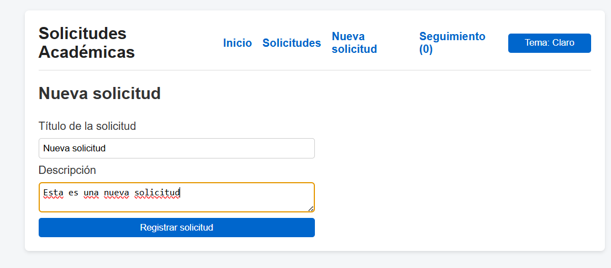
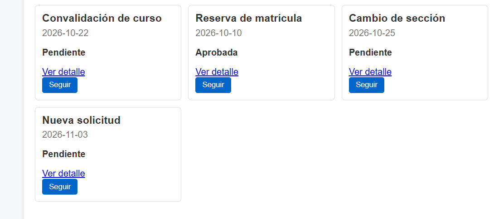
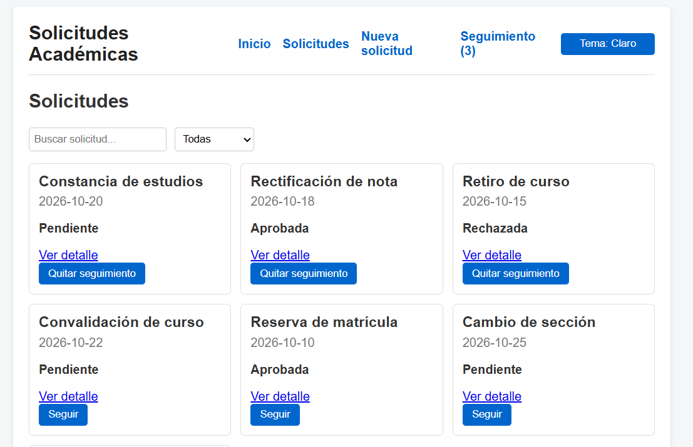
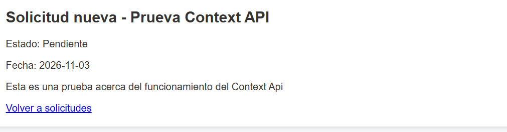
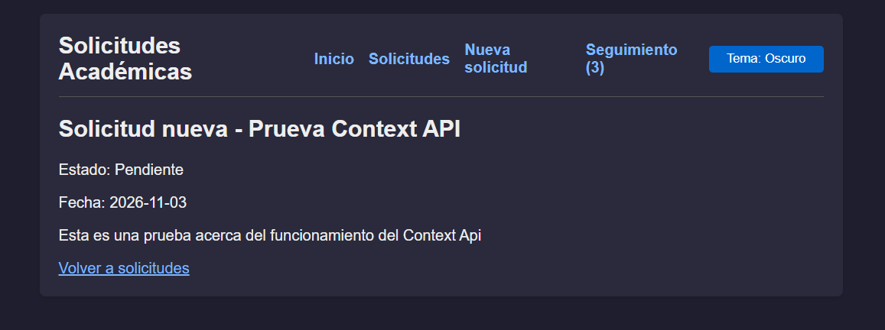

# Plataforma de Gestión de Solicitudes Académicas

## 1. Datos generales del proyecto

**Nombre del proyecto:** Plataforma de Gestión de Solicitudes Académicas - PA3
**Curso:** Programación Web II  
**Tecnologías:** React, JavaScript, Redux, Context API, React Router y Vite.  
**Tipo de aplicación:** Aplicación web de gestión de solicitudes académicas.

## 2. Integrantes, roles y participación

| Integrante | Rol | Responsabilidad | Participación |
|---|---|---|---|
| Integrante 1: Angel Jesús Vargas Manrique | Desarrollador de navegación y estado global con Redux | Implementación de rutas, navegación, Redux, acciones y seguimiento de solicitudes. | Parte 1 |
| Integrante 2: Roy Giovanni Quiroz Morales | Desarrollador de componentes y Hooks | Componentes funcionales, buscador, filtros, efectos, formulario controlado y documentación README. | Parte 2 |
| Integrante 3: Joseph Mathios Labra Espinal | Desarrollador de gestión de estado con Context API | Contexto de solicitudes, Provider, contexto de tema claro/oscuro y comparación técnica entre Context API y Redux. | Parte 3 |

> **Nota sobre el equipo:** Aunque las pautas indicaban un grupo de 4 a 5 integrantes, un compañero nos avisó que no podría participar por inconvenientes personales. Nos organizamos entre los 3 para cubrir todas las partes y completar la aplicación al 100%.

## 3. Descripción del proyecto

La Plataforma de Gestión de Solicitudes Académicas es una aplicación web desarrollada con React que permite representar el proceso de registro, consulta y seguimiento de solicitudes realizadas dentro de una institución educativa.

El sistema permite visualizar solicitudes académicas, consultar sus detalles, buscar registros por título, filtrar por estado y registrar nuevas solicitudes. También incorpora una funcionalidad de seguimiento mediante Redux.

La aplicación utiliza componentes reutilizables, Hooks de React, navegación mediante React Router y mecanismos de gestión de estado global.

## 4. Objetivo del proyecto

Desarrollar una aplicación web interactiva que permita gestionar solicitudes académicas mediante el uso de React, aplicando componentes funcionales, Hooks, navegación, Redux y Context API.

Asimismo, se busca comprender las diferencias entre los mecanismos de gestión de estado global y aplicar buenas prácticas de organización, reutilización y mantenimiento del código.

## 5. Desarrollo del proyecto

### Parte 1. Router y Redux

Se implementó la navegación entre las diferentes secciones de la aplicación utilizando React Router.

Las principales funcionalidades desarrolladas fueron:

- Configuración de las rutas principales:
  - `/`: página de inicio.
  - `/solicitudes`: listado de solicitudes.
  - `/solicitud/:id`: detalle de una solicitud.
  - `/nueva`: formulario de nueva solicitud.
  - `/seguimiento`: solicitudes guardadas para seguimiento.
- Implementación de navegación mediante el componente `Link`.
- Utilización de `useParams` para obtener el identificador de una solicitud desde la URL.
- Mantenimiento del componente de clase y creación de una página de error 404.
- Configuración del store de Redux.
- Creación de acciones para agregar y quitar solicitudes del seguimiento.
- Conexión de Redux con la aplicación mediante `Provider`.
- Utilización de `useSelector` para consultar el estado global.
- Utilización de `useDispatch` para ejecutar acciones desde las tarjetas de solicitudes.

### Parte 2. Componentes, Hooks y README

Se desarrollaron componentes funcionales reutilizables para organizar la información de las solicitudes.

**Componentes principales:**

- `ListaSolicitudes.jsx`: muestra el conjunto de solicitudes y gestiona el mensaje cuando no existen resultados.
- `TarjetaSolicitud.jsx`: presenta la información individual de cada solicitud y permite acceder al detalle o agregarla al seguimiento.

**Aplicación de Hooks:**

- `useState`: controla los estados del buscador, los filtros, la carga y los formularios.
- `useEffect` con arreglo vacío: simula la carga inicial de solicitudes y muestra un mensaje de espera.
- `useEffect` con dependencia: actualiza la búsqueda después de un intervalo de tiempo.
- Función de limpieza: cancela los temporizadores anteriores mediante `clearTimeout`.

**Formulario controlado:**

Se desarrolló un formulario para registrar nuevas solicitudes utilizando `useState`, controlando los campos de título y descripción.

En la versión final, el formulario obtiene la función `agregarSolicitud` desde Context API, y las nuevas solicitudes se agregan al estado global.

Las nuevas solicitudes reciben automáticamente un identificador, una fecha de registro y el estado inicial «Pendiente».

### Parte 3. Context API y comparación

Se implementó Context API para compartir información entre componentes sin pasar props manualmente.

- `SolicitudesContexto` y `SolicitudesProvider`: guardan la lista de solicitudes y la función `agregarSolicitud`.
- `TemaContexto` y `TemaProvider`: guardan el tema (claro u oscuro) y la función `alternarTema`.
- `useContext` en `Solicitudes`, `DetalleSolicitud`, `NuevaSolicitud` y `App`.
- Los Providers se agregan en `main.jsx`, dentro de `BrowserRouter`.
- Un botón en la barra de navegación cambia el tema de toda la aplicación.
- `App.jsx` dejó de manejar el estado de las solicitudes.
- Se corrigió el detalle: ahora también muestra las solicitudes nuevas, porque lee la lista del contexto.

**Justificación del estado global**

Los datos que necesitan ser compartidos entre diferentes vistas deben administrarse mediante un mecanismo de estado global.

En este proyecto, la lista de solicitudes requiere estar disponible en el listado, el detalle y el formulario de registro. Por ello, su centralización evita duplicar información y facilita su actualización.

Por otro lado, las solicitudes seleccionadas para seguimiento se administran mediante Redux, mientras que las preferencias visuales pueden gestionarse mediante Context API.

**Comparación técnica: Context API y Redux**

| Criterio | Context API | Redux |
|---|---|---|
| Propósito | Compartir información entre componentes. | Gestionar estados globales y sus actualizaciones. |
| Configuración | Utiliza `createContext` y Provider. | Utiliza store, reducers y acciones. |
| Acceso al estado | Mediante `useContext`. | Mediante `useSelector`. |
| Actualización | Mediante funciones proporcionadas por el Provider. | Mediante acciones y `useDispatch`. |
| Complejidad | Menor configuración para estados sencillos. | Mayor estructura y organización. |
| Aplicación en el proyecto | Solicitudes compartidas y tema visual. | Seguimiento de solicitudes. |

**Conclusión de la comparación:** Context API resulta conveniente para compartir información y preferencias entre componentes, mientras que Redux ofrece una estructura centralizada para administrar estados y acciones específicas. Ambos mecanismos pueden coexistir dentro de una misma aplicación.

## 6. Solución desarrollada

La solución consiste en una aplicación web construida con React que integra navegación, visualización de información, registro de solicitudes y seguimiento.

El sistema permite:

1. Acceder a la página principal.
2. Consultar el listado de solicitudes académicas.
3. Buscar solicitudes por título.
4. Filtrar solicitudes por estado.
5. Visualizar el detalle de cada solicitud.
6. Registrar nuevas solicitudes.
7. Incorporar automáticamente los nuevos registros al listado.
8. Agregar o quitar solicitudes del seguimiento mediante Redux.
9. Compartir las solicitudes y cambiar el tema visual mediante Context API.

## 7. Estructura general del proyecto

```text
PA3-4060-PWA/
│
├── public/
├── src/
│   ├── components/
│   │   ├── ListaSolicitudes.jsx
│   │   ├── TarjetaSolicitud.jsx
│   │   └── FormularioContacto.jsx
│   │
│   ├── context/
│   │   ├── SolicitudesContexto.js
│   │   ├── SolicitudesProvider.jsx
│   │   ├── TemaContexto.js
│   │   └── TemaProvider.jsx
│   │
│   ├── data/
│   │   └── solicitudes.js
│   │
│   ├── pages/
│   │   ├── Inicio.jsx
│   │   ├── Solicitudes.jsx
│   │   ├── DetalleSolicitud.jsx
│   │   ├── NuevaSolicitud.jsx
│   │   ├── Seguimiento.jsx
│   │   └── NoEncontrado.jsx
│   │
│   ├── redux/
│   │   ├── seguimiento.js
│   │   └── store.js
│   │
│   ├── App.jsx
│   ├── main.jsx
│   └── index.css
│
├── package.json
└── README.md
```

*Nota: la estructura puede ampliarse con los archivos de Context API y los Providers correspondientes, según la integración final de la Parte 3.*

## 8. Tecnologías utilizadas

- **React:** desarrollo de interfaces mediante componentes.
- **JavaScript:** lógica y comportamiento de la aplicación.
- **React Router DOM:** navegación entre páginas.
- **Redux:** administración del estado de seguimiento.
- **React Redux:** conexión de Redux con los componentes.
- **Context API:** mecanismo de estado compartido.
- **Vite:** herramienta de desarrollo y ejecución.
- **CSS:** estilos y presentación visual.

## 9. Cómo ejecutar el proyecto

### Requisitos previos

- Node.js instalado.
- npm instalado.
- Editor de código, preferentemente Visual Studio Code.
- Navegador web actualizado.

### Instalación

Clonar el repositorio:

```bash
git clone https://github.com/JosephLabraE/PA3-4060-PWA.git
```

Ingresar a la carpeta:

```bash
cd PA3-4060-PWA
```

Instalar las dependencias:

```bash
npm install
```

Ejecutar el servidor de desarrollo:

```bash
npm run dev
```

Abrir en el navegador la dirección local que proporciona Vite, normalmente:

```text
http://localhost:5173
```

## 10. Evidencias del proyecto

En esta sección se incorporarán capturas de pantalla que demuestren el funcionamiento de las principales funcionalidades.

| N.º | Evidencia | Descripción |
|---|---|---|
| 1 |  | Página principal y barra de navegación. |
| 2 |  | Listado de solicitudes académicas. |
| 3 |  | Buscador y filtro por estado. |
| 4 |  | Mensaje de carga inicial. |
| 5 |  | Detalle de una solicitud. |
| 6 |  | Registro de una nueva solicitud. |
| 7 |  | Nueva solicitud visualizada en el listado. |
| 8 |  | Funcionalidad de seguimiento con Redux. |
| 9 |  | Implementación de Context API. |
| 10 |  | Cambio entre tema claro y oscuro. |

## 11. Conclusiones

- El desarrollo permitió aplicar los fundamentos de React mediante componentes funcionales y reutilizables.
- Se comprendió la importancia de los Hooks `useState` y `useEffect` para administrar estados y ejecutar efectos secundarios.
- Se implementó la navegación entre páginas utilizando React Router DOM.
- Se aplicó Redux para gestionar las solicitudes seleccionadas para seguimiento.
- Se desarrolló un formulario controlado que permite registrar nuevas solicitudes y visualizar los resultados en el listado.
- La integración de Context API permite comprender otras alternativas para compartir información entre componentes.
- La comparación entre Redux y Context API permitió identificar sus diferencias, ventajas y posibles escenarios de utilización.
- Context API permitió eliminar el paso de props de la lista de solicitudes y aplicar un tema visual en toda la aplicación

En conclusión, el proyecto permitió integrar diferentes herramientas del ecosistema React para construir una aplicación web organizada, interactiva y escalable.

## 12. Video de presentación

**Video público de YouTube:** https://youtu.be/uBlrve-qCsQ

El video presenta la solución desarrollada, explica las funcionalidades principales, muestra la implementación técnica y cuenta con la participación de los tres integrantes del equipo.
 